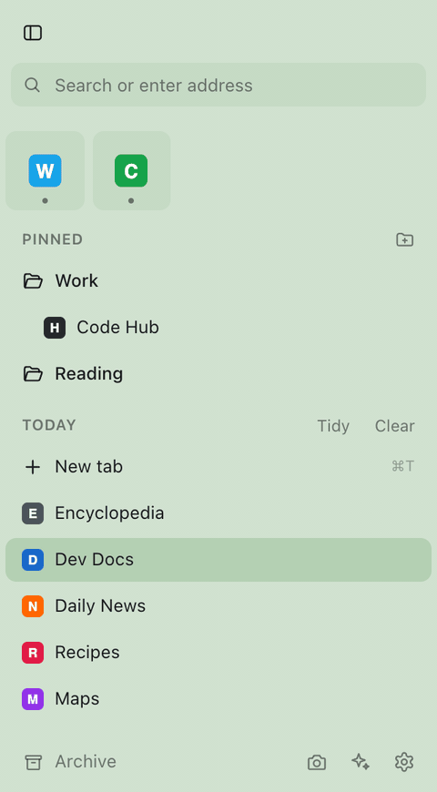
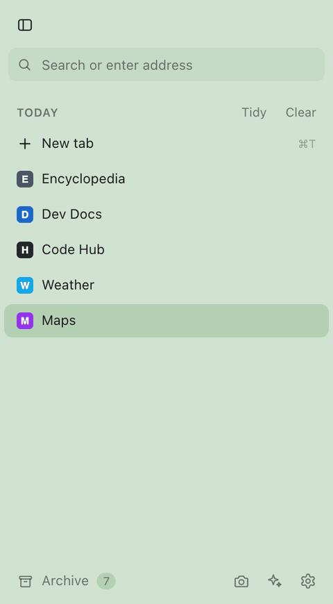
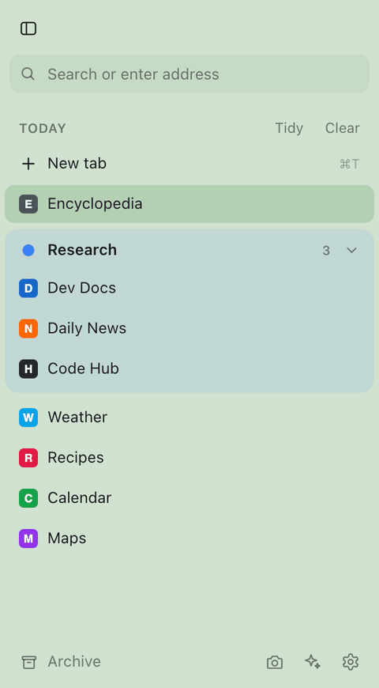
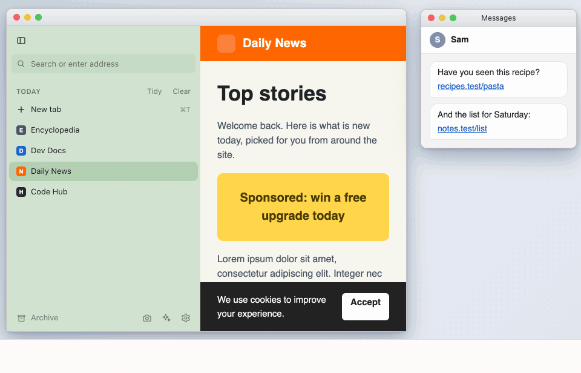
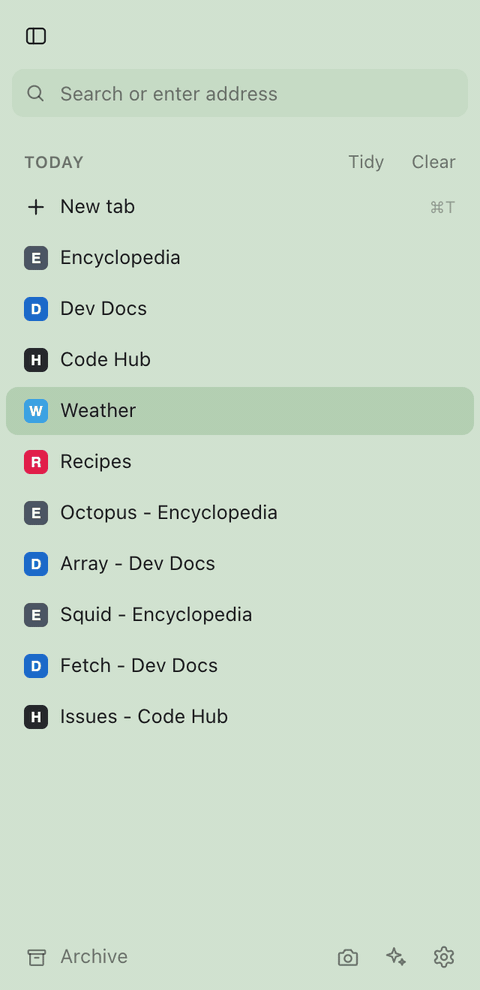
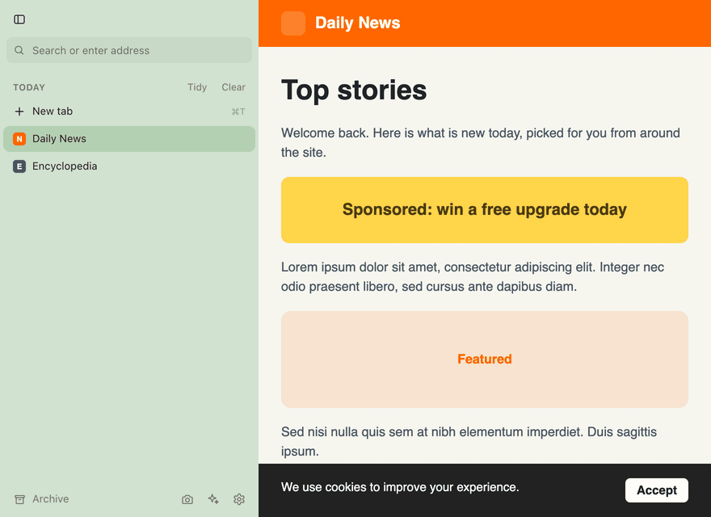
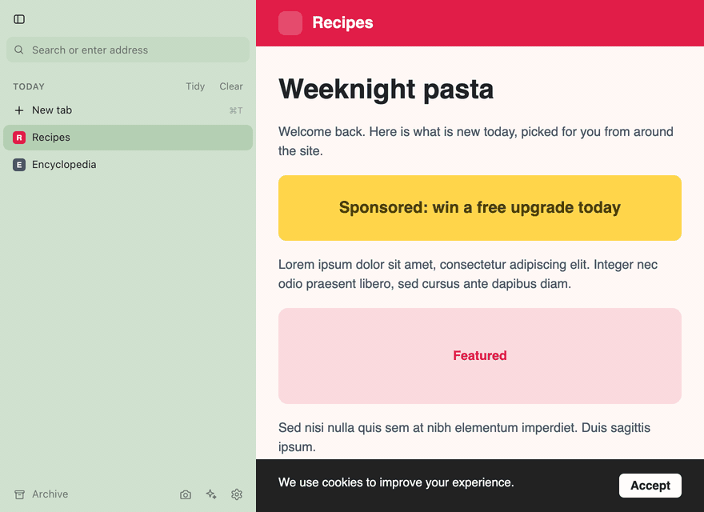
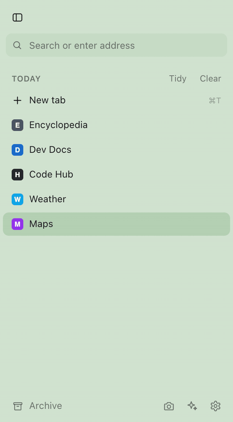
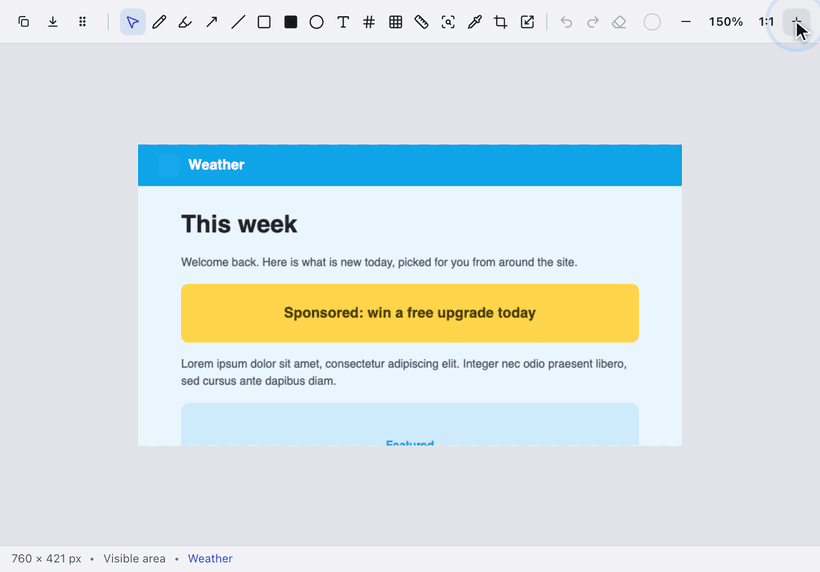
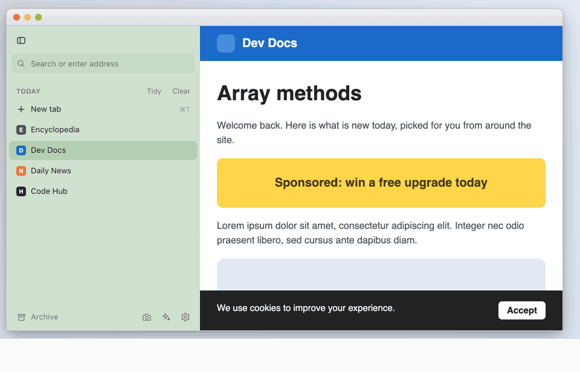

# Stile

A vertical side panel for Chrome on Mac: favourites, pinned folders, today's tabs, auto-archive, and profile switching.

> **Beta:** Stile is still in beta. Expect rough edges, and please [open an issue](https://github.com/jeremyhaber/Stile/issues) if something breaks. Download Stile.app from [Releases](https://github.com/jeremyhaber/Stile/releases).

## What it does

**Favourites and pinned folders**
Drag a tab from Today onto the favourites area, or into a pinned folder, to keep it.

**Archive**
Tabs you haven't used for a while (12 hours by default) move to the Archive. Search it and click to bring one back.

**Tab groups**
Groups are coloured, collapsible sections. Drag a tab onto a group to add it.

**Little windows**
Links from other apps open in a small window and wait in the Temporary list. Make one a full tab to keep it.

**Tidy and Clear**
Tidy groups tabs by website, Clear archives the whole list. Both have Undo.

**Boosts: Zap**
Click elements on a page to hide them, for that site only.

**Boosts: custom CSS**
Add your own CSS to a site and it applies straight away.

**Downloads**
Hover Archive to see recent downloads and the progress of the ones in flight.

**Screenshots**
Capture a page, then mark it up with boxes, arrows and text.

**Screen recording**
Record a tab, a window or an area of the screen, then trim it and save, copy or upload.

(Regenerate these with `node tools/demos/build.mjs`; see Development.)

## 1. Install the extension (in each Chrome profile)

1. Move this `Stile` folder somewhere permanent, e.g. `~/Applications/Stile`. Chrome loads it from there, so don't delete it.
2. Open `chrome://extensions`, turn on **Developer mode** (top right).
3. Click **Load unpacked** and choose the `extension` folder.
4. Repeat in every profile you want it in (switch profile, then steps 2–3).

Open the panel with the toolbar button or **Option+S** (change it at `chrome://extensions/shortcuts`).

**Put the panel on the left:** Chrome Settings → Appearance → Side panel position → Left.

## 2. Install Stile.app (Mac)

Stile.app draws the sidebar over Chrome's vertical tabs and also handles profile switching and settings shared across profiles. See `mac/README.md` for building and setup. In short: open Stile.app, allow Accessibility, then click **Set up** next to "Chrome vertical tabs" in the welcome window. It turns on vertical tabs in every profile and turns off Chrome's own expand-on-hover (it would fight the sidebar's peek). Chrome restarts and reopens your tabs.

To do it by hand instead, in each profile: right-click Chrome's tab bar → **Show tabs vertically**. If you turned on "Expand on hover" for the tabs, turn it off.

The extension needs Stile.app. Until the app is installed and running, the side panel and the settings window show a "Stile.app required" screen with a download link (or, if the app was set up before, Open Stile.app and Retry). They switch back on by themselves once the app connects.

## 3. Optional: allow custom JavaScript in Boosts

Zap and custom CSS work straight away. To run your own JavaScript on a site, open `chrome://extensions`, click **Details** on Stile, and turn on **Allow User Scripts** (do this in each profile). The Boost view shows a button that takes you there.

## How it works

- **Favourites** (tiles at the top) and **Pinned** (folders below) are stored as normal bookmarks in *Other bookmarks → Sidebar*, so they sync to your other computers and stay separate per profile.
- Drag a tab from **Today** onto the favourites area or into Pinned to keep it. Drag it back to Today to unpin. Right-click for rename, new folder, and more.
- A pinned item works in every window: click it to switch to it, or open it if it isn't open in that window yet. If you've wandered off, the ↶ button takes you back to the pinned page.
- **Auto-archive** closes Today tabs you haven't used for a while (default 12 hours) and keeps them in **Archive** (bottom left), where you can search and restore them. Favourites, pinned items, Chrome-pinned tabs, the active tab and tabs playing audio are never archived. Set it per profile, or set a default for all profiles, in settings.
- **Every window shows every tab in the profile.** This window's tabs come first, then a section per other window. Click a tab from another window to bring it here.
- **New windows:** drag a tab, group or split to the "Drop to open in a new window" zone at the bottom, use "Move to new window" in the right-click menu, or the window button in the footer.
- **Tab groups** show as coloured, collapsible sections. Drag tabs onto a group to add them; right-click a group to rename, recolour, ungroup or move it. Grouped tabs aren't auto-archived unless you turn that on in settings.
- **Split view:** drag a tab onto the middle of another tab, or right-click → "Split with…". This needs Chrome 155 or newer; on older versions the menu says so.
- **Pinned reset:** if a pinned tab has wandered off, the row shows "/ current site". Click the ↶ button, click the favicon, or right-click → "Go back to pinned page".
- **Main window and pop-outs:** the first window you open is the main one. Pop a tab out with "Move to new window"; click **Merge** on a window in the panel (or **Merge all**) to bring tabs back with their groups. Closing a pop-out window moves its tabs back to the main window automatically (a window with only one tab is archived instead). Right-click a window to make it the main one. You can turn automatic merging off in settings.
- **Bringing a tab over:** clicking a tab that's open in another window moves it here, and that window switches to its next tab.
- **Tab actions** (right-click a tab): Rename, Duplicate, Close tabs above / below / others / all. Double-click a tab's title to rename it; the new name also shows in Chrome's tab bar.
- **Clear** archives every tab in this window's Today list, **Tidy** groups tabs by website. Both have Undo.
- **Boosts** (sparkle button next to the address field): per site, for that exact hostname only. **Zap** lets you click elements on the page to hide them; **Code** adds your own CSS and JavaScript.
- **Profiles** show as icons at the top. Click one to switch: its window opens (or comes forward) at the same size and position, and the current one minimises. Change each profile's icon and colour in settings or by right-clicking its icon; the panel takes on the current profile's colour.

## Known limits

- Profile switching is two windows trading places, so there's a brief flicker.
- Typed searches open in Chrome's last-focused window.
- Boosts can't run on Chrome's own pages or the Chrome Web Store.
- Custom JavaScript runs from the next page load after you save.
- Stile.app shows its sidebar in macOS full screen only when Chrome's View → "Always Show Toolbar in Full Screen" is ticked. Otherwise Chrome's own side panel is used there.
- When you share a single Chrome window in Meet or Zoom, viewers see Chrome's native vertical tabs, not Stile's sidebar, because Stile.app draws the sidebar in its own windows. To show the sidebar, share your entire screen. Sharing a tab shows only the page.

## Development

- `node tools/e2e.mjs` — end-to-end test in Chromium (extension + real helper with a fake Chrome profile list).
- `node tools/boost-e2e.mjs` — Boost (Zap/Code) tests.
- `node tools/fake-app/test-host.mjs` — host protocol tests against the Node reference of Stile.app's host.
- `node tools/overlay-e2e.mjs` — the sidebar UI in overlay mode, driven like Stile.app does.
- `node tools/demos/build.mjs [scene ...]` — rebuilds the README demo GIFs in `docs/demos/` (headless Chromium, fake data only, needs ffmpeg); see `tools/demos/README.md`.

## License

MIT. See [LICENSE](LICENSE).
